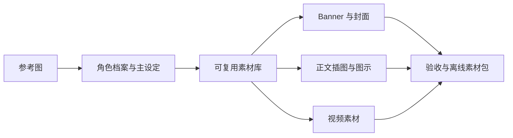

# Personal IP Kit

**上传一张参考图，建立自己的角色；以后每篇文章、每张封面都沿用它。**

一个可复用的 Agent Skill：支持人物、宠物、动物、植物、水果和物品角色。每个人带自己的图片与角色档案，共用同一套创作流程。



## 可以做什么

- **创建 IP**：从参考图建立主设定、头像、透明立绘、表情或状态、场景与封面。
- **持续配图**：读取文章或大纲，规划配图位置，让角色参与解释、演示和对比。
- **多角色管理**：每个角色独立保存原图、主板、规范和素材；显式角色选择优先，避免串角色。
- **可编辑排版**：生成画面与长标题、数据、流程图分层，保留无字原图与可编辑版本。
- **视频分流**：区分透明素材、二维出场动画、生成式角色视频和真正三维模型。
- **检查与交付**：验证文件、透明通道和相对路径，导出离线预览页、manifest 与 ZIP。

本仓库包含通用技能与脚本，不包含某位用户的私人照片、个人角色档案或访问凭据。

## 安装

项目级安装，在你希望使用技能的项目根目录执行（目标目录应不存在）：

```bash
git clone https://github.com/Eileenes/personal-ip-kit.git .agents/skills/personal-ip-kit
```

也可将仓库放到你的工具支持的用户级 skills 目录。仓库根目录的 `SKILL.md` 是入口；Codex 界面元数据位于 `agents/openai.yaml`。如果新安装的技能尚未出现在会话中，重新打开会话或直接提供 `SKILL.md` 路径。

技能需要支持图片参考的生图工具，优先使用运行环境内置能力。安装 skill 不会安装生图模型，也不会自动提供视频生成、三维建模服务或 API 额度。只读取流程不需要 Python；运行辅助脚本需要 Python 3.10+ 与 Pillow：

```bash
python3 -m venv .venv
.venv/bin/python -m pip install -r .agents/skills/personal-ip-kit/requirements.txt
```

## 直接这样使用

**新建自己的 IP**

> 使用 $personal-ip-kit。根据我上传的照片创建一个适合教程内容的 3D 卡通角色，先做主设定让我看，再扩展素材。

**已有形象，直接做一套**

> 使用 $personal-ip-kit。沿用这张角色图，做一张 Banner、两张文中解释图和一个透明引导动作。主题由你根据我的定位决定，直接完成并打包。

**给文章配图**

> 使用 $personal-ip-kit，沿用当前项目的默认角色，为下面这篇文章制作封面与必要的解释图。优先复用素材，保留可编辑标题。

**切换角色**

> 使用 $personal-ip-kit，这次使用角色 my-cat，给宠物用品介绍做封面。不要改变项目默认角色。

**制作视频素材**

> 使用 $personal-ip-kit，沿用我的角色做开场素材。如果有可用动画工具，导出一段弹出回弹的二维动画；如果没有，请明确交付素材和分镜。

## 角色存在哪里

角色素材保存在使用者的项目内，与技能代码分开。索引示例：

```text
your-project/
├── .agents/skills/personal-ip-kit/  # 通用技能
├── .ip-characters/index.json       # 当前项目的角色索引
├── characters/my-character/
│   ├── character.json
│   ├── reference/
│   ├── master.png
│   └── brand-guide.md
└── ip-output/my-character/         # 每次内容产物
```

已有素材库可以原地新增档案，不必搬迁图片。具体格式见 [角色档案规范](references/characters.md)。建议在使用者项目的 `.gitignore` 中加入私人角色目录；技能仓库的忽略规则不会自动保护另一个项目。

```bash
python3 .agents/skills/personal-ip-kit/scripts/character_profile.py init \
  --id my-character --name 我的角色 \
  --reference ./my-reference.png --output ./characters/my-character

python3 .agents/skills/personal-ip-kit/scripts/character_profile.py validate \
  ./characters/my-character/character.json

python3 .agents/skills/personal-ip-kit/scripts/character_profile.py resolve --project .
```

`init` 只复制参考并初始化草案，不会自动生图或修改默认角色。技能在完成主板后更新档案，维护项目索引。

## 交付与边界

典型交付为：独立图片、实际提示词与参考记录、品牌手册、可编辑排版、验收记录、离线素材库和 ZIP。打包示例见 [打包规范](references/packaging.md)。导出包包含清单明确列出的参考图，适合本人备份或明确授权的分享；分享通用 skill 不需要附带这些图。

一致性来自参考图、主设定、素材复用和视觉检查，不保证每张图完全相同。角色风格由用户决定，不预设橙色外套、眼镜或任何特定人物。二维图片不能冒充可旋转模型，静态素材不能冒充已经渲染的视频。

## 验证

```bash
python3 -m unittest discover -s tests -v
```

自动检查覆盖角色分离与选择、参考路径、不可覆盖初始化、透明素材与打包完整性。它们不证明某个生图模型会画得相像，也不代表已在所有宿主工具中运行过。

技能结构参考 [OpenAI Skills 文档](https://developers.openai.com/plugins/build/skills)。
